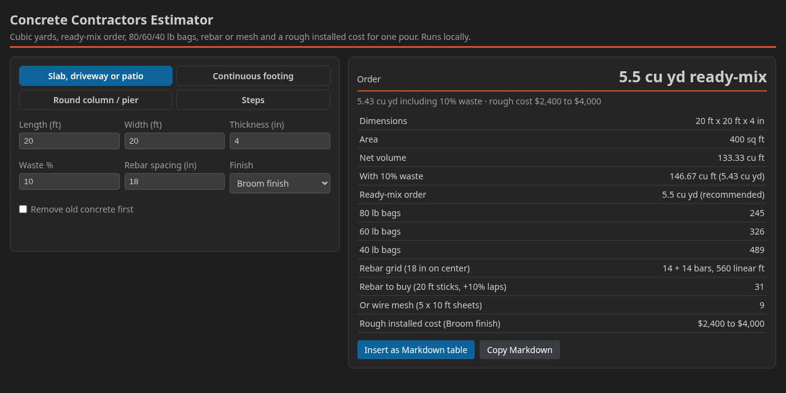

# Concrete Contractors Estimator for VS Code

The take-off concrete contractors run before every pour, inside your editor. Enter the dimensions of a
slab, driveway, patio, continuous footing, round column or set of steps and get the volume in cubic
yards with waste, the ready-mix order rounded to the quarter yard, 80/60/40 lb bag counts, a rebar grid
or wire mesh count and a rough installed cost range. Then insert it into your job notes, bid or README
as a Markdown table.

The maths is the same estimator published on npm as
[`concrete-contractors-estimator`](https://www.npmjs.com/package/concrete-contractors-estimator).



## Features

- **Estimator panel**: `Concrete Contractors: Open Estimator` opens a live calculator with four shapes
  (slab/driveway/patio, continuous footing, round column or pier, steps). Results update as you type.
- **Cubic yards and ready-mix order**: volume with a configurable waste allowance, rounded up to the
  next 1/4 yard the way plants dispatch it, with a bags-vs-truck recommendation.
- **Bag counts**: 80 lb (0.60 cu ft), 60 lb (0.45 cu ft) and 40 lb (0.30 cu ft) premix bags.
- **Rebar and mesh**: grid bar count and linear feet at your spacing, 20 ft sticks to buy with 10% for
  laps, or 5 x 10 ft wire mesh sheets.
- **Rough installed cost**: broom, colored, exposed aggregate or stamped finish, with optional tear-out.
- **Insert as Markdown**: `Concrete Contractors: Insert Concrete Estimate (Markdown Table)` walks you
  through the dimensions and writes the table at the cursor; the panel has *Insert* and *Copy* buttons.
- **Private by design**: no telemetry, no network requests, no accounts. The webview runs under a
  strict Content Security Policy and only loads files bundled with the extension.

## Usage

1. Open the Command Palette (`Ctrl+Shift+P` / `Cmd+Shift+P`).
2. Run **Concrete Contractors: Open Estimator**, pick a shape and type the dimensions.
3. Click **Insert as Markdown table**, or run **Concrete Contractors: Insert Concrete Estimate** from any
   Markdown file (also on the editor right-click menu).

Example output for a 20 x 20 ft, 4 in slab:

| Item | Value |
|---|---|
| Dimensions | 20 ft x 20 ft x 4 in |
| Area | 400 sq ft |
| Net volume | 133.33 cu ft |
| With 10% waste | 146.67 cu ft (5.43 cu yd) |
| Ready-mix order | 5.5 cu yd (recommended) |
| 80 lb bags | 245 |
| 60 lb bags | 326 |
| 40 lb bags | 489 |
| Rebar grid (18 in on center) | 14 + 14 bars, 560 linear ft |
| Rebar to buy (20 ft sticks, +10% laps) | 31 |
| Or wire mesh (5 x 10 ft sheets) | 9 |
| Rough installed cost (Broom finish) | $2,400 to $4,000 |

## Settings

| Setting | Default | Meaning |
|---|---|---|
| `concreteContractorsEstimator.wastePercent` | `10` | Waste allowance added to the net volume |
| `concreteContractorsEstimator.rebarSpacing` | `18` | Rebar spacing in inches on center (slabs) |
| `concreteContractorsEstimator.finish` | `broom` | Finish used for the cost range (`broom`, `colored`, `exposed`, `stamped`) |

Figures are planning estimates, not a bid. Always confirm the order with your ready-mix supplier.

## Development

```bash
npm run compile      # syntax-check every script
npm test             # unit tests for the volume, bag, rebar and cost maths
npm run screenshot   # re-render images/screenshot.png with headless Chrome
npm run package      # build the .vsix with @vscode/vsce
```

`npm run sync-core` copies the shared estimator from `packages/npm/lib/index.js`.

## Links

Built and maintained by a licensed [concrete contractor in Phoenix](https://concretecontractorsphoenix.net/) for driveways, patios, stamped concrete, slabs and foundations.

- Source: <https://github.com/nbkdevs/concrete-contractors-phoenix/tree/main/packages/vscode>
- Privacy: the extension collects nothing. Site privacy policy: <https://concretecontractorsphoenix.net/privacy-policy/>

## License

MIT
